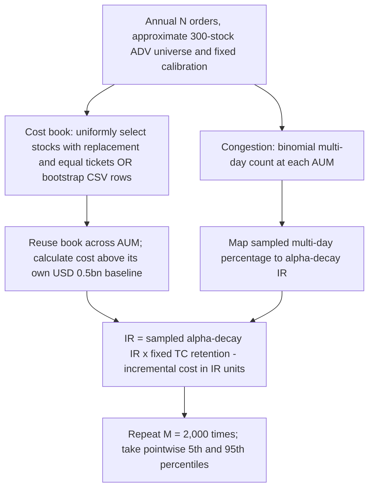

# Capacity Lab: objectives, approaches and calibration

## 1. Objective of the exercise

Estimate how net performance changes as assets under management (AUM) grow, and identify the AUM at which net information ratio (IR) reaches a chosen minimum. This supports capacity planning by making assumptions explicit; capacity is not treated as a fixed property of the strategy.

The dashboard reports net IR, annual net alpha, and minimum-IR and zero-IR AUM thresholds. IR is net alpha divided by tracking error. Use consistent return horizons and risk conventions when comparing results.

**Two AUM references have different jobs.** Current AUM anchors historical trading observations. Universe-mode order notionals are derived from AUM, turnover and annual order count. USD 0.5bn starts the calibrated net-IR curve. The sampler preview defaults to current AUM; the empirical curve starts at USD 0.5bn.

## 2. Two complementary approaches

### 2.1 Empirical approach

The **Empirical IR curve** combines observed trading and liquidity inputs with three calibrated pillars: impact costs, alpha decay and transfer-coefficient (TC) decay. It asks what happens if orders grow and the chosen execution and implementation assumptions hold.

Trading observations inform impact costs. Alpha-decay and TC points are user estimates, not parameters automatically inferred from trade history. Model Calibration makes them visible and editable.

### 2.2 Backtest approach

The **Backtest IR curve** fits a decreasing power curve to AUM–IR observations from optimised historical backtests. Use comparable periods, risk conventions and cost definitions. The sidebar permits adjustments to the fitted curve. Replace illustrative dashboard observations before interpreting the comparison as historical evidence.

**Read the approaches together.** Summary compares current IR and capacity thresholds. Differences indicate assumptions worth reviewing. The curves remain separate: they are not averaged, and the backtest fit does not calibrate the empirical pillars.

## 3. Empirical approach: inputs, pillars and calibration

### 3.1 Inputs

Confirm that the observations in **Inputs & strategy** correspond to current AUM.

| Input | Purpose and units |
|---|---|
| Current AUM | Size at which observed orders apply; USD billions |
| Universe ADV percentiles | Locally saved boundaries interpolated in log USD to approximate 300 individual stocks |
| Annual parent orders | Default 971 across four quarters, about 81 per month |
| Historical ADV buckets | Participation boundaries, representative ratios and estimated costs for fitting and comparison |
| Order counts and value | Historical count and notional shares are comparison data, not universe selection probabilities |
| Estimated bucket impact | Positive basis points per traded dollar |
| One-way annual turnover | Buys plus sells / AUM is twice this turnover fraction |
| Tracking error | Fixed annual active-return risk, entered in percent |
| Calibration triples | Three points each for alpha decay and TC |
| Minimum net IR | Threshold used to indicate capacity |

Alternatively, upload actual parent orders with positive `q` and `adv` in the same currency. The CSV supplies order sizes and liquidity; estimated bucket costs still calibrate the impact curve.

### 3.2 Three model pillars

#### Impact costs: larger orders are more expensive to trade

The ADV bucket sampler automatically fits a nonnegative power cost curve to estimated bucket impacts. Each bucket has equal fitting weight; aggregate portfolio costs use traded-notional weights. There are no per-bucket sliders or manual impact-fit controls.

Approximate a 300-stock universe by interpolating in log USD between the locally saved ADV percentiles at equally spaced midpoint stock ranks. This does not recover actual individual stock observations. Sample stocks uniformly with replacement for each annual book of **971 equal-notional parent orders**.

For one-way turnover fraction $T$ and AUM $A$ in USD billions, each ticket is:

$$q(A)=2TA10^9/N,\qquad x_i(A)=q(A)/ADV_i.$$

At USD 3.4bn, 13.90% turnover and 971 orders, each order is USD 973,429.45. Every book trades exactly twice one-way turnover times AUM. Annual order count and universe size are editable in Inputs & strategy; turnover is in Model Calibration. Four quarters define the annual horizon, not a simulated quarterly schedule.

The ADV distribution determines bucket frequencies. Reuse the same stock selections at current AUM, ×2 and ×3; scale tickets while ADV stays fixed. Include an overflow bucket. Historical bucket frequencies are a comparison, not a calibration target, so uniform selection and equal tickets can produce materially different frequencies.

Annual drag in bp equals average impact multiplied by twice one-way turnover. Equal tickets make count and notional weights identical. Actual CSV orders retain their individual notionals and ADV pairs. Fitted costs outside the observed participation range are extrapolations; the market-impact literature [3] motivates nonlinear costs but does not validate this specific fit.

#### Alpha decay: execution congestion reduces performance

Provide three **(AUM, % trades taking more than one day, net IR)** points. Two linked power curves connect AUM to multi-day percentage, then multi-day percentage to IR. Curvatures fit automatically.

| AUM (USD bn) | Trades >1 day | Net IR |
|---:|---:|---:|
| 0.50 | 0.00% | 0.60 |
| 3.00 | 2.00% | 0.57 |
| 6.00 | 10.00% | 0.50 |

These defaults isolate alpha decay with other effects fixed. Multi-day percentage counts orders equally regardless of notional or forecast strength. It does not distinguish two-day from ten-day orders.

#### Transfer coefficient: implementation efficiency declines

Provide three **(TC, AUM, annual alpha)** points. Two linked power curves connect AUM to TC, then TC to annual alpha. Here alpha means annual net alpha with other effects fixed.

| TC | AUM (USD bn) | Annual alpha |
|---:|---:|---:|
| 60.00% | 0.50 | 1.00% |
| 40.00% | 3.00 | 0.60% |
| 25.00% | 6.00 | 0.30% |

Divide calibrated alpha by its initial value to obtain **TC-alpha retention**: 100.00%, 60.00% and 30.00% at the default points. This is not the raw TC ratio. The defaults imply nonlinear AUM-to-TC decay and a linear TC-to-alpha link; other triples can change curvature. Initial 1.00% is a normalising reference, not a second absolute alpha anchor.

### 3.3 Calibration workflow

1. Confirm current AUM, trading observations, estimated impacts, tracking error and turnover.
2. Inspect the automatic impact fit and trading-book distribution in Model Calibration. Adjust AUM, sample count, seed or turnover as needed.
3. Edit alpha-decay triples and inspect both links. AUM uses USD 0.5bn increments; multi-day percentages increase and IR decreases.
4. Edit TC triples: AUM increases; TC and annual alpha decrease. Review retention.
5. Review Empirical IR curve and Summary, which update immediately in the combined model. Save through Inputs & strategy.

### 3.4 How the pillars combine

Start with alpha-decay IR, multiply by TC-alpha retention, and deduct **only the increase in impact costs above USD 0.5bn**, expressed in IR units:

$$IR(A)=I_\alpha(A)H_{TC}(A)-\Delta C_{IR}(A).$$

The initial net-IR point already includes baseline costs, so baseline cost is not deducted again. Defaults give IR before incremental costs of 0.57 × 0.60 = 0.342 at USD 3bn and 0.50 × 0.30 = 0.150 at USD 6bn. Net IR at USD 0.5bn remains 0.60. Annual net alpha in percent equals net IR times tracking error in percent.

### 3.5 Reading the results

Empirical IR curve shows net IR and net alpha. Summary compares empirical and backtest capacity and decomposes the empirical decline into alpha-decay, TC and incremental-impact contributions.

Capacity is the first AUM from USD 0.5bn where the central curve reaches the chosen threshold. A threshold not reached within range does not imply unlimited capacity. Predictions beyond calibration points are labelled extrapolation. The combined domain stops at the first zero retained-alpha factor or an earlier pillar-domain limit.

**Deterministic** is the default: a central curve without intervals. **Monte Carlo** adds conditional 5th–95th percentile ranges. Tables display at most two decimals; calculations, stored values and CSV exports retain full precision.

## Appendix. Simulation assumptions and calculation notes

### What Monte Carlo samples

A sample is an alternative trading book and congestion outcome, not an individual trade-alpha forecast. Initial settings are 2,000 samples and seed 2026; universe mode uses the annual order count (default 971); CSV mode uses the number of observed rows.

The two random paths are independent. The workflow for one simulation is:

**M versus N:** M is the number of simulations; N is the annual order count in each universe book (or observed row count for CSV). Increasing M improves numerical stability without increasing N. Only the cost book is reused across AUM; congestion counts do not follow individual trade identities across AUM. The central curve uses calibrated congestion and mean simulated impact, rather than the mean of simulated final IR. Binomial/multinomial sampling follows standard count models [1]; CSV resampling is the empirical bootstrap [2].

- **Universe ADV: uniform stock selection.** Approximate 300 stock ADVs from saved percentile boundaries. Draw N stocks with replacement, equivalently multinomial stock counts with equal probabilities. Each order has equal notional determined by AUM, turnover and N. Order/ADV determines the bucket; historical bucket shares do not determine selection.
- **Actual trades: empirical bootstrap.** Observed complete order-notional/ADV pairs are sampled uniformly with replacement. Equal selection probability does not establish equal alpha contribution.
- **Congestion: binomial counts.** Independently of cost-book sampling, multi-day counts use the annual book size and the calibrated multi-day probability. The sampled percentage maps into IR, with simulated alpha retention floored at zero.

The same cost book is reused across AUM and compared with its own USD 0.5bn baseline. TC and parameters stay fixed. More samples improve numerical stability without increasing orders per book or resolving assumption uncertainty. The seed makes draws reproducible.

### Interpretation and limitations

Orders are exchangeable for alpha-decay purposes: no trade-specific alpha forecasts or delay sensitivities are modelled. This is a count-based approximation, not an allocation of equal alpha dollars to every trade. Costs remain notional-weighted.

Congestion draws and cost composition are independent, although difficult trades may carry more or less alpha in reality. Ranges exclude this dependence, parameter uncertainty, clustered orders and changing liquidity. Uniform stock selection, equal tickets and interpolation of stock ADVs are additional assumptions. Historical bucket frequencies need not be reproduced. They are conditional pointwise ranges, not simultaneous bands or performance guarantees. The centre uses calibrated congestion and mean simulated impact, not the nonlinear simulation mean. Ranges collapse at USD 0.5bn.

The Fundamental Law of Active Management motivates separating skill, independent breadth and implementation efficiency. The dashboard does not estimate skill or breadth, and its TC scenario is not an estimated forecast-to-position correlation.

### Units and fitted relationships

AUM uses USD billions; order/ADV is a fraction internally and a percentage in the interface. Alpha and tracking error use percentage points. For annual portfolio cost $C(A)$ in bp and tracking error $TE$ in percent:

$$\Delta C_{IR}(A)=\frac{C(A)-C(0.5)}{100TE}.$$

### Academic foundations and model choices

The references support the sampling methods and economic motivation: count distributions [1], empirical bootstrap [2], nonlinear market impact [3], decaying return predictors and trading costs [4], and active-management/implementation efficiency [5,6]. Our uniform stock selection, equal tickets, interpolated ADV universe, calibration triples, congestion-to-IR and TC-alpha mappings, independence assumption and multiplicative combination remain dashboard modelling choices. These papers do not validate those choices or make the simulated ranges full forecast confidence intervals.

### References

1. Agresti, A. (2002). Introduction: Distributions and Inference for Categorical Data. *Categorical Data Analysis*, 2nd ed., Chapter 1. Wiley. [doi:10.1002/0471249688.ch1](https://doi.org/10.1002/0471249688.ch1).
2. Efron, B. (1979). Bootstrap Methods: Another Look at the Jackknife. *The Annals of Statistics*, 7(1), 1-26. [doi:10.1214/aos/1176344552](https://doi.org/10.1214/aos/1176344552).
3. Almgren, R., Thum, C., Hauptmann, E., and Li, H. (2005). *Direct Estimation of Equity Market Impact*. Working paper, 10 May 2005. [Full paper](https://www.cis.upenn.edu/~mkearns/finread/costestim.pdf).
4. Garleanu, N., and Pedersen, L. H. (2013). Dynamic Trading with Predictable Returns and Transaction Costs. *The Journal of Finance*, 68(6), 2309-2340. [doi:10.1111/jofi.12080](https://doi.org/10.1111/jofi.12080).
5. Grinold, R. C. (1989). The Fundamental Law of Active Management. *The Journal of Portfolio Management*, 15(3), 30-37. [doi:10.3905/jpm.1989.409211](https://doi.org/10.3905/jpm.1989.409211).
6. Clarke, R. G., de Silva, H., and Thorley, S. (2002). Portfolio Constraints and the Fundamental Law of Active Management. *Financial Analysts Journal*, 58(5), 48-66. [doi:10.2469/faj.v58.n5.2468](https://doi.org/10.2469/faj.v58.n5.2468).
