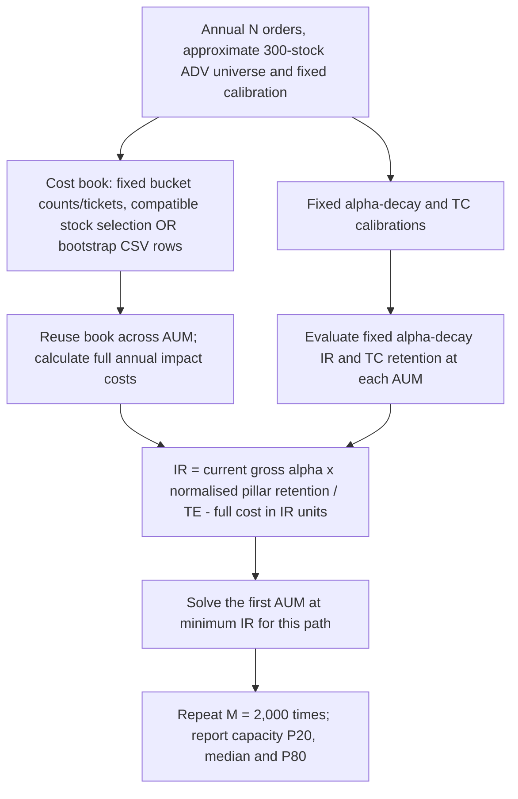

# Capacity Lab: objectives, approaches and calibration

Co-authors: Rodrigo Dupleich and Onder Gundol.

## 1. Objective of the exercise

Estimate how net performance changes as assets under management (AUM) grow, and identify the AUM at which net information ratio (IR) reaches a chosen minimum. This supports capacity planning by making assumptions explicit; capacity is not treated as a fixed property of the strategy.

The main output is the **20th–80th percentile interval of AUM at minimum net IR** from simulated trading books. The dashboard also reports net IR, annual net alpha, central capacity, and zero-IR AUM. IR is net alpha divided by tracking error. Use consistent return horizons and risk conventions when comparing results.

**Current AUM is the strategy anchor.** Baseline gross alpha is editable annual alpha at current AUM, before impact costs. Current AUM also anchors historical orders. USD 0.5bn is the lower calculation boundary; its net IR is implied, not fixed at 0.60.

## 2. Two complementary approaches

### 2.1 Empirical approach

The **Empirical IR curve** combines observed trading and liquidity inputs with three calibrated pillars: impact costs, alpha decay and transfer-coefficient (TC) decay. It asks what happens if orders grow and the chosen execution and implementation assumptions hold.

Trading observations inform impact costs. Alpha-decay and TC points are user estimates defining relative retention shapes; current-AUM gross alpha sets the combined level. Model Calibration makes them visible and editable.

### 2.2 Backtest approach

The **Backtest IR curve** fits a decreasing power curve to AUM–IR observations from optimised historical backtests. Use comparable periods, risk conventions and cost definitions. The sidebar permits adjustments to the fitted curve. Replace illustrative dashboard observations before interpreting the comparison as historical evidence.

**Read the approaches together.** Summary compares current IR and capacity thresholds. Differences indicate assumptions worth reviewing. The curves remain separate: they are not averaged, and the backtest fit does not calibrate the empirical pillars.

## 3. Empirical approach: inputs, pillars and calibration

### 3.1 Inputs

Confirm that the observations in **Inputs & strategy** correspond to current AUM.

| Input | Purpose and units |
|---|---|
| Current AUM | Gross-alpha and historical order-size anchor; USD billions |
| Baseline gross alpha | Annual alpha before impact costs at current AUM; percent |
| Universe ADV percentiles | Locally saved boundaries interpolated in log USD to approximate 300 individual stocks |
| Annual parent orders | Default 971 annually across 12 monthly rebalances, about 81 per month |
| Historical ADV buckets | Participation boundaries, representative ratios and estimated costs for fitting and comparison |
| Order counts and value | Historical count and notional shares are comparison data, not universe selection probabilities |
| Estimated bucket impact | Positive basis points per traded dollar |
| One-way annual turnover | Buys plus sells / AUM is twice this turnover fraction |
| Tracking error | Fixed annual active-return risk, entered in percent |
| Calibration triples | Three points each for alpha decay and TC |
| Minimum net IR | Threshold used to indicate capacity |

Alternatively, upload actual parent orders with positive `q` and `adv` in the same currency. The CSV supplies order sizes and liquidity; estimated bucket costs still calibrate the impact curve.

### 3.2 Three model pillars

#### Impact costs: larger orders are more expensive to trade

The ADV bucket sampler automatically fits a nonnegative power cost curve to estimated bucket impacts. Each bucket has equal fitting weight; aggregate portfolio costs use traded-notional weights. There are no per-bucket sliders or manual impact-fit controls.

Approximate 300 stock ADVs by log-dollar interpolation of saved percentiles at midpoint ranks. Fix current-AUM bucket counts to history: **801, 113, 33, 18, 5, 1** (971 annual orders). If bucket b has historical traded-value share w_b and fixed count n_b, its ticket is:

$$q_b(A)=2TA10^9w_b/n_b,\qquad x_{bi}(A)=q_b(A)/ADV_i.$$

Draw n_b stocks uniformly with replacement **only among compatible stocks** whose current-AUM order/ADV falls inside bucket b. Ticket sizes are constant within a bucket but differ across buckets. Every book exactly preserves historical count and notional shares at current AUM and total annual traded dollars `2*T*A*1e9`. Monthly rebalancing partitions the same annual book into twelve books without changing its cost. Custom annual counts use largest-remainder allocation and ensure at least one order per populated bucket; infeasible ADV inputs raise errors. At zero turnover, tickets and drag are zero and historical bucket matching is inapplicable.

Reuse the same sampled orders at current AUM, ×2 and ×3, scaling tickets while ADV stays fixed. Reclassify naturally, retaining an overflow bucket. The migration chart shows mean frequencies across simulated books. Participation rate is an execution-time reference, not a bucket-assignment cap.

Annual impact drag equals notional-weighted impact multiplied by twice one-way turnover. Actual CSV mode bootstraps complete q/ADV pairs. Fitted costs beyond observed participation are extrapolations; the impact literature [3] motivates nonlinear costs but does not validate this specific fit.

#### Alpha decay: execution congestion reduces performance

Provide three **(AUM, % trades taking more than one day, net IR)** points. Two linked power curves connect AUM to multi-day percentage, then multi-day percentage to IR. Curvatures fit automatically.

| AUM (USD bn) | Trades >1 day | Net IR |
|---:|---:|---:|
| 0.50 | 0.00% | 0.60 |
| 3.00 | 2.00% | 0.57 |
| 6.00 | 10.00% | 0.50 |

These defaults isolate alpha decay with other effects fixed. Their IR ratios define relative retention, not the absolute level of combined net IR. Multi-day percentage counts orders equally regardless of notional or forecast strength. It does not distinguish two-day from ten-day orders.

#### Transfer coefficient: implementation efficiency declines

Provide three **(TC, AUM, annual alpha)** points. Two linked power curves connect AUM to TC, then TC to annual alpha. Here alpha means annual net alpha with other effects fixed.

| TC | AUM (USD bn) | Annual alpha |
|---:|---:|---:|
| 60.00% | 0.50 | 1.00% |
| 40.00% | 3.00 | 0.60% |
| 25.00% | 6.00 | 0.30% |

Divide calibrated alpha by its initial value to obtain **TC-alpha retention**: 100.00%, 60.00% and 30.00% at the default points. This is not the raw TC ratio. The defaults imply nonlinear AUM-to-TC decay and a linear TC-to-alpha link; other triples can change curvature. Initial 1.00% is a normalising reference, not a second absolute alpha anchor.

### 3.3 Calibration workflow

1. Confirm current AUM, trading observations, estimated impacts, tracking error and turnover.
2. Inspect the automatic impact fit and trading-book distribution in Model Calibration. Adjust AUM, sample count, seed or turnover as needed.
3. Edit alpha-decay triples and inspect both links. AUM uses USD 0.5bn increments; multi-day percentages increase and IR decreases.
4. Edit TC triples: AUM increases; TC and annual alpha decrease. Review retention.
5. Review Empirical IR curve and Summary, which update immediately in the combined model. Save through Inputs & strategy.

### 3.4 How the pillars combine

Multiply alpha-decay retention and TC-alpha retention into $R(A)$, then normalise at current AUM. With gross alpha $G_{current}$ in percent, annual impact $C(A)$ in bp and tracking error $TE$ in percent:

$$IR(A)=\frac{G_{current}R(A)/R(A_{current})-C(A)/100}{TE}.$$

The gross-alpha curve passes exactly through the entered gross alpha at current AUM in every simulation. Full impact costs are deducted once. For example, 0.60% gross less 13.00bp cost gives 0.47% net alpha and IR 0.47/1.30 ≈ 0.36. Net alpha equals IR times tracking error. The 0.5bn net IR is implied, not a separate anchor. Current AUM must lie below the zero-retention boundary.

### 3.5 Reading the results

Empirical IR curve shows net IR and net alpha. Summary shows capacity results and comparison tables for both approaches, with the simulation histogram last. The pillar-loss breakdown is in Empirical IR curve.

Capacity is the first AUM from USD 0.5bn where the central curve reaches the chosen threshold. A threshold not reached within range does not imply unlimited capacity. Predictions beyond calibration points are labelled extrapolation. The combined domain stops at the first zero retained-alpha factor or an earlier pillar-domain limit.

**Monte Carlo** is the default: simulate complete curves and display pointwise 20th–80th percentile IR bands. **Deterministic** remains available without intervals. Stock selections (or CSV orders) and an independent final-IR Gaussian term vary; alpha-decay and TC curves stay fixed. Tables display at most two decimals; calculations, stored values and CSV exports retain full precision.

### 3.6 Capacity interval: the final objective

For each complete simulated IR path, solve its first AUM at minimum IR. Report the 20th, 50th and 80th percentiles of those crossing AUMs in Summary, together with a distribution chart and the percentage reaching the threshold within the horizon. P20–P80 is a central 60% conditional simulation interval. It is **not** obtained by intersecting the pointwise IR band with the threshold.

A path not crossing within the chosen horizon or model domain remains a beyond-horizon outcome. Keep it in percentile calculations; never discard it or invent a crossing at the horizon. Percentiles beyond the horizon display a lower bound. Export every simulated crossing and its censoring indicator as CSV.

## Appendix. Simulation assumptions and calculation notes

### What Monte Carlo samples

A sample is an alternative annual trading book, not an individual trade-alpha forecast. Stock selection (or CSV resampling) and an optional final-IR Gaussian shock vary; alpha-decay and TC curves stay fixed. Initial settings are 2,000 samples and seed 2026; universe mode uses the annual order count (default 971); CSV mode uses the number of observed rows.

The workflow for one simulation is:

**M versus N:** M is the number of simulations; N is the annual order count in each universe book (or observed row count for CSV). Increasing M improves numerical stability without increasing N. Reuse each cost book across AUM. Alpha-decay and TC curves are identical for all draws; before the final shock, rising costs and falling retention make paths nonincreasing. The final Gaussian term can produce recoveries. The central curve uses mean impact and zero expected final shock. Multinomial sampling follows standard count models [1]; CSV resampling is the empirical bootstrap [2].

- **Universe ADV: conditional stock selection.** Each bucket has a fixed annual order count and ticket determined by historical count and value shares. Draw compatible stock ADVs uniformly with replacement, equivalently multinomial stock counts within each bucket. Baseline composition is fixed; within-bucket participation and migration are random.
- **Actual trades: empirical bootstrap.** Observed complete order-notional/ADV pairs are sampled uniformly with replacement. Equal selection probability does not establish equal alpha contribution.

The same cost book is reused across AUM; full impact costs are deducted from gross alpha once. TC and parameters stay fixed. More samples improve numerical stability without increasing orders per book or resolving assumption uncertainty. The seed makes draws reproducible.

### Interpretation and limitations

Orders are exchangeable for alpha-decay purposes: no trade-specific alpha forecasts or delay sensitivities are modelled. This is a count-based approximation, not an allocation of equal alpha dollars to every trade. Costs remain notional-weighted.

Alpha-decay, congestion percentages, TC, tracking error and fitted cost parameters stay fixed across draws. Difficult trades may carry more or less alpha in reality. Ranges exclude that dependence, parameter uncertainty, clustered orders and changing liquidity. Conditional uniform selection, constant tickets within each bucket and interpolation of stock ADVs are additional assumptions. Baseline historical count and value shares are imposed, not random. The IR band is pointwise and the capacity interval comes from per-path threshold crossings. These are conditional ranges, not simultaneous bands or performance guarantees. The centre uses zero expected Gaussian shock; its finite-simulation mean can differ slightly. Ranges need not collapse at USD 0.5bn or current AUM: gross alpha is fixed, but sampled impact costs vary.

The Fundamental Law of Active Management motivates separating skill, independent breadth and implementation efficiency. The dashboard does not estimate skill or breadth, and its TC scenario is not an estimated forecast-to-position correlation.

### Units and fitted relationships

AUM uses USD billions; order/ADV is a fraction internally and a percentage in the interface. Annual gross/net alpha and tracking error use percentage points. Full annual impact $C(A)$ in bp converts to IR units as $C(A)/(100TE)$. The optional breakdown reconciles losses from the model-implied net IR at USD 0.5bn; baseline costs are not deducted twice.

### Academic foundations and model choices

The references support the sampling methods and economic motivation: count distributions [1], empirical bootstrap [2], nonlinear market impact [3], decaying return predictors and trading costs [4], and active-management/implementation efficiency [5,6]. Our fixed bucket counts, bucket-specific tickets, conditional stock selection, interpolated ADV universe, calibration triples, congestion-to-IR and TC-alpha mappings, fixed alpha and TC curves and multiplicative combination remain dashboard modelling choices. These papers do not validate those choices or make the simulated ranges full forecast confidence intervals.

### References

1. Agresti, A. (2002). Introduction: Distributions and Inference for Categorical Data. *Categorical Data Analysis*, 2nd ed., Chapter 1. Wiley. [doi:10.1002/0471249688.ch1](https://doi.org/10.1002/0471249688.ch1).
2. Efron, B. (1979). Bootstrap Methods: Another Look at the Jackknife. *The Annals of Statistics*, 7(1), 1-26. [doi:10.1214/aos/1176344552](https://doi.org/10.1214/aos/1176344552).
3. Almgren, R., Thum, C., Hauptmann, E., and Li, H. (2005). *Direct Estimation of Equity Market Impact*. Working paper, 10 May 2005. [Full paper](https://www.cis.upenn.edu/~mkearns/finread/costestim.pdf).
4. Garleanu, N., and Pedersen, L. H. (2013). Dynamic Trading with Predictable Returns and Transaction Costs. *The Journal of Finance*, 68(6), 2309-2340. [doi:10.1111/jofi.12080](https://doi.org/10.1111/jofi.12080).
5. Grinold, R. C. (1989). The Fundamental Law of Active Management. *The Journal of Portfolio Management*, 15(3), 30-37. [doi:10.3905/jpm.1989.409211](https://doi.org/10.3905/jpm.1989.409211).
6. Clarke, R. G., de Silva, H., and Thorley, S. (2002). Portfolio Constraints and the Fundamental Law of Active Management. *Financial Analysts Journal*, 58(5), 48-66. [doi:10.2469/faj.v58.n5.2468](https://doi.org/10.2469/faj.v58.n5.2468).

## Backtest uncertainty calibration

Model Calibration → **d) Backtest uncertainty** provides two saved controls: IR standard deviation at current AUM (`backtest_sd`, default 0.03) and expansion rate (`backtest_expansion`, default 1). For fitted mean `mu(A)=a-b*A**gamma`, deviation is `sigma(A)=sd0*(A/current_AUM)**rate`. Rate 0 gives constant width; 1 doubles deviation at twice current AUM; 2 quadruples it. Zero deviation collapses all paths to the fitted curve.

Each full path is `IR_j(A)=mu(A)+Z_j*sigma(A)`, with one standard-normal shock reused across all AUMs. Errors are perfectly correlated across AUM by assumption, and Gaussian at each point. The exact pointwise P20–P80 band is `mu ± 0.8416*sigma`; it describes the central 60%, not a simultaneous band. Inputs are assumed backtest estimation uncertainty, not fitted standard errors. Repeated backtests or a block bootstrap of return histories could later estimate them.

Each path's first minimum-IR crossing gives a capacity observation. The solver checks turning points because sufficiently optimistic paths can flatten or rise at high AUM. Already-below paths return $0.5bn; unreached paths are right-censored at the selected backtest horizon and retained in capacity P20/P50/P80. The backtest horizon is independent of the empirical retention boundary. Sample count and seed are shared with the ADV controls, but a separate random stream makes the approaches independent. Summary includes both ranges, scenario bands and an overlaid histogram; the backtest tab exports the curve and every capacity draw. Deterministic mode hides result bands and intervals.

## Final empirical IR uncertainty

After all three pillars, each path adds `Z_j * empirical_sd * (A/current_AUM)**empirical_expansion`, where Z is standard normal and independent of its sampled trading book. Defaults are 0.03 IR deviation and expansion rate 1. One shock is reused across every AUM on the path, giving perfectly correlated residual errors across AUM. These are assumed residual model uncertainties, not fitted standard errors. Setting deviation to zero restores stock-selection-only uncertainty. The combined distribution is a mixture over cost books, not necessarily Gaussian.

Set both saved controls in Capacity Lab → Empirical IR curve — advanced parameters or Empirical IR curve → Final empirical IR uncertainty. The central curve and current net-alpha/IR anchor are unchanged. P20–P80 IR bands use combined path quantiles. Capacity P20/P50/P80 come from each full path's first crossing of minimum IR, not inversion of pointwise bands. Search a shared 1,025-point grid plus calibration knots, refine intervening local minima, then bisect the earliest crossing. This numerical search handles crossing followed by recovery. Unreached paths remain right-censored and included in capacity percentiles. CSV exports preserve both settings and all draws.
